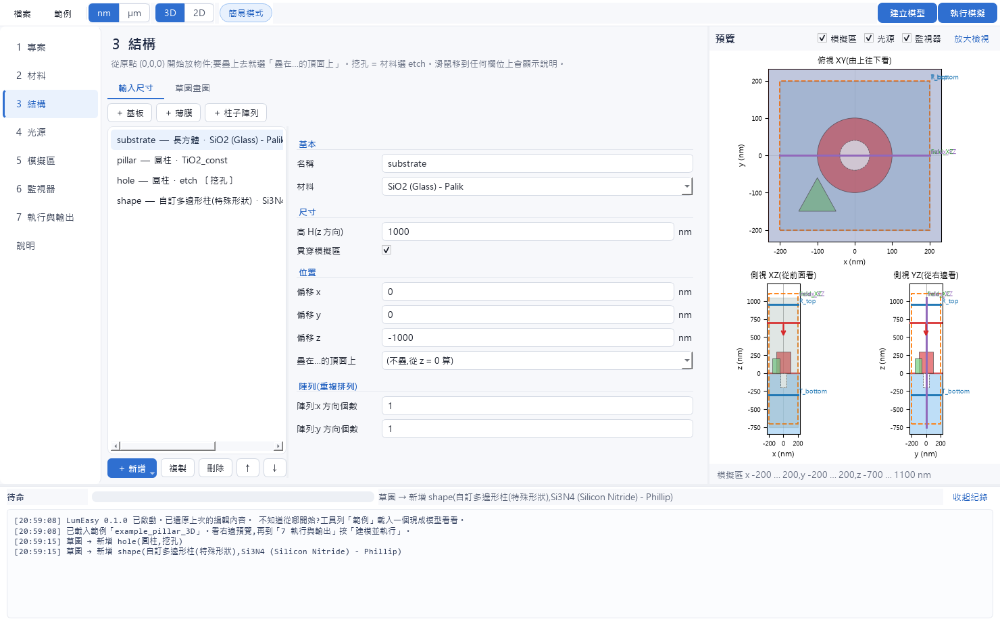
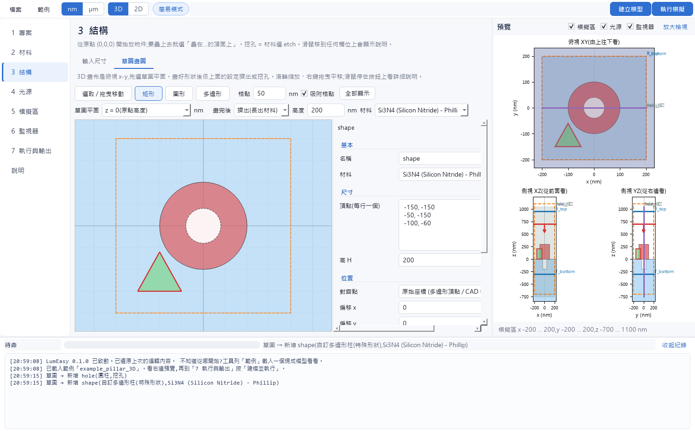
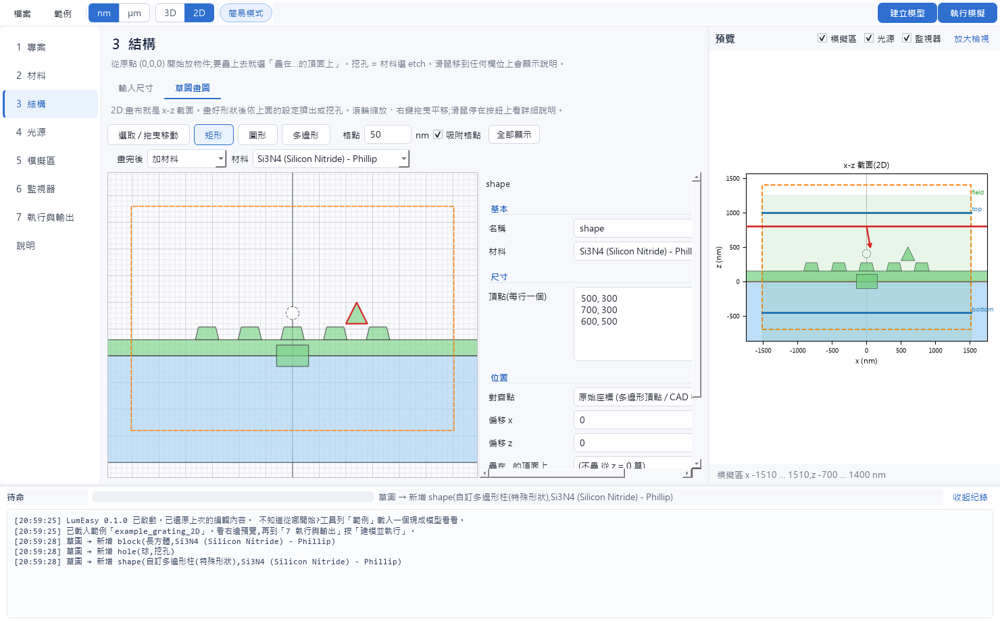
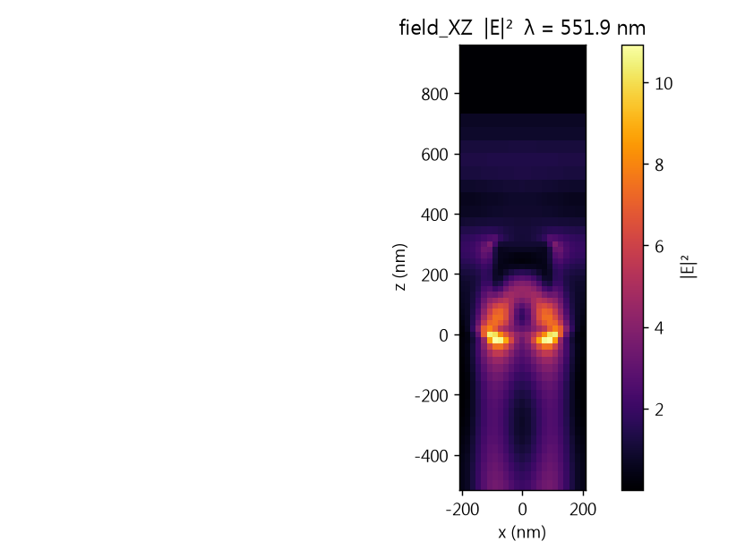
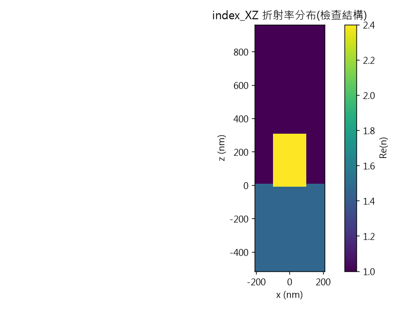

# LumEasy — Lumerical FDTD 一站式建模介面

不用學 Lumerical 的操作介面:**直接輸入尺寸(或用滑鼠在格子上畫)**,就能自動建好 FDTD 模型、放好監視器、跑模擬,
並把結果輸出成 `.npz` / `.mat` / `.h5` / `.csv` / `.png`。

LumEasy 只透過 Lumerical 官方的 Python API(lumapi)和軟體溝通,**不碰授權、不碰授權伺服器、不改系統設定**。



## 功能

- **直譯式建模**:長方體、圓柱、橢圓柱、圓環、球、梯形台(斜側壁)、正多邊形、自訂多邊形;
  從原點 (0,0,0) 開始放,「疊在某物件的頂面上」自動算高度(改下層厚度,上層跟著動);陣列一鍵複製上萬個。
- **草圖建模(像 Onshape)**:在格子上畫矩形 / 圓 / 多邊形 → 擠出或挖孔;草圖平面可以選物件頂面。
  Lumerical 沒有布林減法,挖孔用「etch 材料 + 網格優先順序」實現。
- **CAD 匯入**:STL(一鍵切換檔案單位)、GDSII(點選 cell / 圖層)、DXF(封閉形狀轉多邊形)。
- **材料**:固定 n,k、固定 ε、匯入頻譜檔(n,k 或 ε 都行,自動換算成 Lumerical 要的 ε = (n+ik)²;
  支援 refractiveindex.info 格式)、複製內建材料改擬合參數;n,k ⇄ ε 換算小工具。
- **監視器**:一鍵放上方 / 下方 / 左右前後 / XY、XZ、YZ 截面 / 點 / 封閉盒 / 折射率 / 時域 / 動畫,
  位置以原點為參考;勾選要記錄的電場、磁場分量。
- **光源**:平面波(Bloch / BFAST / 有限)、高斯光、波導模態、偶極子、TFSF。
- **2D 與 3D**:2D 畫的是 x-z 截面,程式自動轉成 Lumerical 的 x-y 平面(偏振、入射角正負號都處理好)。
- **即時預覽**:俯視 + 兩個側視,含模擬區、光源、監視器。
- **一鍵輸出**:場圖(|E|²、|H|²)、穿透率頻譜、折射率分布圖,多種資料格式。
- **滑鼠提示**:每個欄位都說明用途與「對應 Lumerical 的哪個設定」。
- **自動避坑**:中文路徑、session 卡住自動重開、發散偵測、記憶體估計、建模後讀回幾何核對……
  完整清單見 [疑難排解](docs/疑難排解.md)。

| 草圖(3D 俯視) | 草圖(2D 截面) |
|---|---|
|  |  |

| 跑完自動畫的場圖 | 折射率分布(檢查結構) |
|---|---|
|  |  |

## 安裝

### 方法一:直接用 EXE(推薦,不用裝 Python)

1. 到 [Releases](../../releases) 下載 `LumEasy.exe`
2. 雙擊執行。第一次開啟約需 10–20 秒(解壓)。Windows 若跳出「已保護您的電腦」(程式沒有數位簽章),按「其他資訊 → 仍要執行」。

Releases 的 EXE 由 GitHub Actions 在雲端自動打包(`.github/workflows/release.yml`:推送 `v*` 標籤 → 測試 → 打包 → 自我測試 → 建立 Release 草稿)。

### 方法二:從原始碼執行

1. 安裝 [Python 3.10 以上](https://www.python.org/downloads/)(勾選 *Add python.exe to PATH*)
2. 下載這個專案(綠色 Code 按鈕 → Download ZIP,解壓到任何資料夾,路徑有中文也可以),雙擊 **`install.bat`**
   (自動建立虛擬環境、安裝套件、在桌面建立捷徑、跑自我測試,約 3 分鐘)
3. 之後雙擊桌面的 LumEasy,或執行 `run.bat`

自己打包 EXE:雙擊 `build_exe.bat`(先跑單元測試,打包後跑自我測試),完成後在 `dist\LumEasy.exe`。
`.bat` 只是啟動器,實際步驟在 `tools\install.ps1`、`tools\build_exe.ps1`(只對這次執行放寬 PowerShell 執行原則,不改系統設定)。

### 需求

- Windows 10 / 11(64 位元)
- 已安裝 **Ansys Lumerical FDTD**(含 Python API,安裝資料夾裡有 `api\python\lumapi.py`)與有效授權。
  會自動尋找 `C:\Program Files\Lumerical\v*` 與 `C:\Program Files\ANSYS Inc\v*\Lumerical`;找不到時可以在「專案」頁手動指定。
- 已在 Lumerical FDTD 2020 R2 測試過(建模、執行、輸出全流程)。

## 快速上手

1. 工具列「範例」→ 選一個範例
2. 「1 專案」選存放資料夾,按「連線測試」
3. 右上角「執行模擬」
4. 結果在存放資料夾:`<檔名>.fsp`(可用 Lumerical 開啟)、`<檔名>.lsf`(建模腳本)、`<檔名>_results\`

詳見 [使用說明](docs/使用說明.md)。

## 專案結構

```
lumeasy/
  model.py      欄位定義、物件擺放與包圍盒(介面依這裡自動產生表單)
  materials.py  材料檔讀取、欄位判斷、n,k ⇄ ε
  cadio.py      STL / GDSII / DXF 讀取
  lsf.py        專案 → Lumerical 腳本(LSF),2D 座標轉換、入射角正負號統一
  worker.py     獨立行程:開 Lumerical、建模、執行、取資料(卡住可整棵行程樹關掉)
  results.py    取資料、存各種格式、畫圖、引擎 log 檢查
  estimate.py   網格與記憶體粗估
  gui/          PySide6 介面(主視窗、各頁、預覽、草圖畫布)
docs/           使用說明、疑難排解
tests/          單元測試(python -m pytest tests,不需要 Lumerical)
tools/          一鍵安裝、打包腳本(install.bat / build_exe.bat 會呼叫)
dev/            開發用的測試與探測腳本(見 dev/README.md)
```

自我測試:`LumEasy.exe --selftest`(不需要 Lumerical)、`LumEasy.exe --selftest run`(會真的開 Lumerical 跑一個 2D 範例),
結果寫在 `%TEMP%\lumeasy_selftest.txt`。

## 授權條款

LumEasy 以 [Apache License 2.0](LICENSE) 釋出:可以自由使用(含商用)、修改、再發布,
再發布時請附上 [LICENSE](LICENSE) 與 [NOTICE](NOTICE),並註明改了哪些地方。
這份條款只涵蓋 LumEasy 本身的程式碼;使用 Lumerical 仍需要你自己的 Ansys 授權。

Copyright 2026 ToleLin

## 聲明

本專案與 Ansys, Inc. 無關。Lumerical 與 Ansys 是 Ansys, Inc. 的商標。
LumEasy 不包含、不修改任何 Lumerical 的檔案,執行時從使用者自己的安裝資料夾載入官方 Python API。
